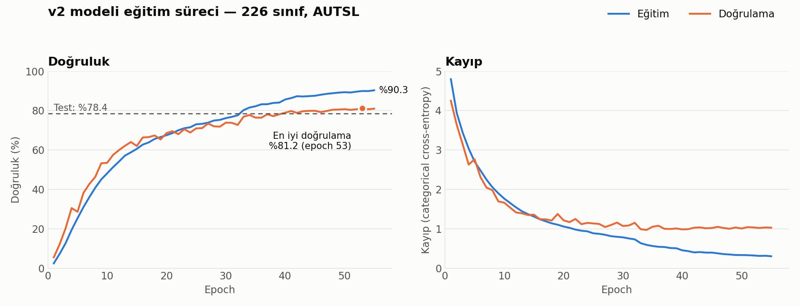
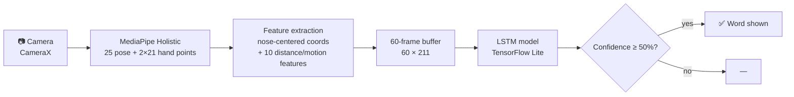

# 🤟 Turkish Sign Language Recognition — Android App

[Türkçe](README.md) | **English**


An Android app that recognizes **Turkish Sign Language (TİD)** words **in real time** from the phone camera.
MediaPipe extracts body and hand landmarks, and an LSTM-based deep learning model classifies the motion sequence into one of **226 signs**. The model runs fully on-device (TensorFlow Lite, ~2.9 MB) — no internet connection required.

> Developed as my undergraduate graduation project.

## ✨ Features
- 📷 **Live recognition:** CameraX frames, continuous prediction over the last 60 frames.
- 🦴 **Skeleton overlay:** detected hand and body landmarks are drawn on screen.
- 📊 **Confidence score & FPS:** predictions below 50% confidence are hidden.
- 📖 **Dictionary:** Turkish/English meaning and a sample video for all 226 signs.
- 🔌 **Offline:** everything runs on the device; no video leaves the phone.
- 🌙 Light / dark theme.

## 📈 Results

| Split | Accuracy |
|---|---|
| Training | **89.9%** |
| Validation | **81.2%** |
| Test (2,808 unseen videos) | **78.4%** |

Other test metrics: F1 (macro) **78.0%** · Precision (macro) **80.0%** · Recall (macro) **78.4%**

<picture>
  <source media="(prefers-color-scheme: dark)" srcset="docs/images/egitim_grafigi_dark.png">
  
</picture>

*(Chart labels are in Turkish: Eğitim = Training, Doğrulama = Validation, Doğruluk = Accuracy, Kayıp = Loss.)*

Training and validation rise together until ~epoch 20; afterwards validation loss plateaus around 1.0 while training loss keeps falling — mild overfitting. The checkpoint with the best validation accuracy (epoch 53) is the one shipped. Random chance over 226 classes is just 0.4%.

## 🧠 How It Works



1. **Landmarks:** MediaPipe Holistic gives 25 pose points and 21 points per hand (x, y, z) for every frame.
2. **Normalization:** all coordinates are centered on the nose, making the model invariant to where the signer stands in the frame.
3. **Extra features:** each hand's distance to the mouth, eye, nose and shoulder, plus hand motion since the previous frame → **211 features per frame**.
4. **Classification:** the 60-frame sequence is fed to a 3-layer LSTM. The exact same preprocessing is implemented in Python (training) and Java (app).

### Model architecture
| Layer | Output |
|---|---|
| LSTM (256) + BatchNorm + Dropout 0.4 | 60 × 256 |
| LSTM (128) + BatchNorm + Dropout 0.4 | 60 × 128 |
| LSTM (64) + BatchNorm + Dropout 0.3 | 64 |
| Dense (128, ReLU) + Dropout 0.3 | 128 |
| Dense (226, Softmax) | 226 |

Training: Adam, categorical cross-entropy, `ReduceLROnPlateau`, `EarlyStopping`, batch size 32.

### Iterations
| Attempt | Input | Model | Validation |
|---|---|---|---|
| First model | 100 frames × 201 features (coordinates only) | 2-layer LSTM (128→64) | ~67% |
| **v2 (shipped)** | **60 frames × 211 features (+ distance/motion)** | **3-layer LSTM (256→128→64)** | **81.2%** |

Shortening the sequence, adding hand-to-face/shoulder distance and motion features, and enlarging the model raised validation accuracy by **14 points**. The first attempt's notebooks are in `notebooks/deneyler/`.

## 🗂️ Dataset
Trained on **[AUTSL — Ankara University Turkish Sign Language Dataset](https://cvml.ankara.edu.tr/datasets/)** (43 signers, 226 signs, ~38,000 videos). Splits: train 28,132 · validation 4,418 · test 2,808 videos.

Due to the dataset license, **no AUTSL data is included** in this repository — including the dictionary sample videos (`app/src/main/res/raw/`).

## 📁 Project Structure
```
android-app/     Android Studio project (Java)
notebooks/       Google Colab notebooks, run in order:
  01  landmark extraction with MediaPipe
  02  training the v2 model
  03  Keras → TFLite conversion
  04  test-set metrics
  05  confusion matrix & per-class report
  deneyler/  earlier experiments
docs/images/     README figures
```

## 🚀 Getting Started
**Prebuilt APK:** download `app-debug.apk` from [Releases](../../releases) (Android 7.0+).

**Build from source:**
1. Open `android-app/` in Android Studio.
2. Place one AUTSL sample video per sign in `app/src/main/res/raw/` as `v<class_id>_<word>.mp4` (e.g. `v0_abla.mp4`), plus `sign_male.mp4` / `sign_female.mp4` for the home screen.
3. Run on a physical device (camera required).

## ⚠️ Limitations
- Recognizes **isolated signs**, not continuous sentences.
- Trained on fixed-camera recordings of 43 signers; accuracy may drop with hand-held phones, unusual lighting or angles.
- Quality degrades when MediaPipe misses hand landmarks (occluded or fast-moving hands).
- ~9-point gap between training and validation accuracy → mild overfitting.
- Facial expressions are not used, although they carry meaning in TİD.

## 🔭 Future Work
- Transformer / temporal-convolution models
- Data augmentation (mirroring, scaling, time-warping)
- Adding face landmarks
- Continuous sign-language (sentence) recognition
- Text-to-speech output

## 🛠️ Tech Stack
Java · Android (CameraX, Media3/ExoPlayer, Material) · MediaPipe Tasks Vision · TensorFlow / Keras · TensorFlow Lite · Python · Google Colab · scikit-learn · pandas · matplotlib

## 📄 License
Source code is released under the [MIT License](LICENSE). The trained model is derived from AUTSL and is for **academic / non-commercial** use only.

## 👤 Author
**Baran Can Demirer** — [GitHub](https://github.com/BaranDemirer)
