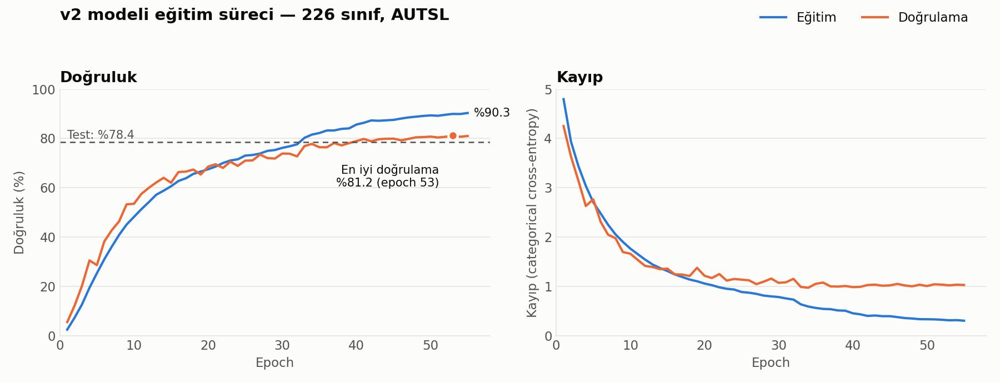
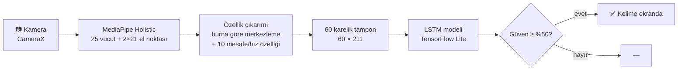

# 🤟 Türk İşaret Dili Tanıma — Android Uygulaması

**Türkçe** | [English](README.en.md)


Telefon kamerasından **Türk İşaret Dili (TİD)** kelimelerini **gerçek zamanlı** tanıyan bir Android uygulaması.
MediaPipe ile vücut ve el iskeleti çıkarılır, LSTM tabanlı bir derin öğrenme modeli bu hareket dizisinden **226 farklı kelimeyi** sınıflandırır. Model tamamen cihaz üzerinde (TensorFlow Lite, ~2.9 MB) çalışır; internet bağlantısı gerekmez.

> Bitirme projesi olarak geliştirilmiştir.

<!-- Ekran görüntüleri eklendiğinde:
<p align="center">
  
  
  
</p>
-->

## ✨ Özellikler
- 📷 **Canlı tanıma:** CameraX ile kameradan görüntü alınır, son 60 kare üzerinden sürekli tahmin yapılır.
- 🦴 **İskelet görselleştirme:** Algılanan el ve vücut noktaları ekranda çizilir.
- 📊 **Güven skoru ve FPS göstergesi:** %50 eşiğin altındaki tahminler gösterilmez.
- 📖 **Sözlük:** 226 kelimenin Türkçe/İngilizce karşılığı ve örnek işaret videosu.
- 🔌 **Çevrimdışı:** Tüm işlem cihazda yapılır, görüntü hiçbir sunucuya gönderilmez.
- 🌙 Açık / koyu tema desteği.

## 📈 Sonuçlar

| Küme | Doğruluk |
|---|---|
| Eğitim | **%89.9** |
| Doğrulama | **%81.2** |
| Test (2.808 video, eğitimde hiç görülmedi) | **%78.4** |

Test kümesinde diğer metrikler: F1 (macro) **%78.0** · Precision (macro) **%80.0** · Recall (macro) **%78.4**

<picture>
  <source media="(prefers-color-scheme: dark)" srcset="docs/images/egitim_grafigi_dark.png">
  
</picture>

Eğitim ve doğrulama eğrileri ~20. epoch'a kadar birlikte yükseliyor. Sonrasında doğrulama kaybı ~1.0'da sabitlenirken eğitim kaybı düşmeye devam ediyor; yani model hafifçe ezberlemeye başlıyor. En iyi doğrulama sonucunun alındığı epoch 53'teki model kaydedildi (`ModelCheckpoint`, `val_accuracy`). 226 sınıfta rastgele tahminin başarısı yalnızca %0.4'tür.

## 🧠 Nasıl Çalışıyor?



1. **Landmark çıkarımı:** MediaPipe Holistic her karede 25 vücut noktası ve her el için 21 nokta (x, y, z) verir.
2. **Normalizasyon:** Tüm koordinatlar burun noktasına göre merkezlenir; kişinin kadrajdaki konumu önemsizleşir.
3. **Ek özellikler:** Her elin ağız, göz, burun ve omuza uzaklığı ile bir önceki kareye göre el hareket miktarı → kare başına **211 özellik**.
4. **Sınıflandırma:** 60 karelik dizi 3 katmanlı LSTM modeline verilir. Aynı ön işleme hem Python'daki eğitimde hem Java'daki uygulamada birebir uygulanır.

### Model mimarisi
| Katman | Çıkış |
|---|---|
| LSTM (256) + BatchNorm + Dropout 0.4 | 60 × 256 |
| LSTM (128) + BatchNorm + Dropout 0.4 | 60 × 128 |
| LSTM (64) + BatchNorm + Dropout 0.3 | 64 |
| Dense (128, ReLU) + Dropout 0.3 | 128 |
| Dense (226, Softmax) | 226 |

Eğitim: Adam optimizer, categorical cross-entropy, `ReduceLROnPlateau` (öğrenme oranı yarıya), `EarlyStopping`, batch 32.

### Geliştirme süreci
| Deneme | Girdi | Model | Doğrulama |
|---|---|---|---|
| İlk model | 100 kare × 201 özellik (yalnızca koordinat) | 2 katman LSTM (128→64) | ~%67 |
| **v2 (uygulamadaki)** | **60 kare × 211 özellik (+ mesafe/hız)** | **3 katman LSTM (256→128→64)** | **%81.2** |

İlk modelde başarı ~%67'de kaldı. Kare sayısı 60'a indirildi, ellerin yüz ve omuza göre konumunu anlatan mesafe özellikleri ile hareket hızı eklendi, model büyütüldü. Doğrulama başarısı **14 puan** arttı. İlk denemenin defterleri `notebooks/deneyler/` klasöründedir.

## 🗂️ Veri Seti
Model, Ankara Üniversitesi tarafından hazırlanan **[AUTSL — Ankara University Turkish Sign Language Dataset](https://cvml.ankara.edu.tr/datasets/)** ile eğitilmiştir (43 kişi, 226 kelime, ~38.000 video). Bölümler: eğitim 28.132 · doğrulama 4.418 · test 2.808 video.

Veri seti lisansı gereği bu repoda **paylaşılmamıştır**. Sözlük ekranındaki örnek videolar (`app/src/main/res/raw/`) da bu nedenle repoya dahil edilmemiştir.

## 📁 Proje Yapısı
```
android-app/          Android Studio projesi (Java)
  app/src/main/java/com/example/isaretdil/
    MainActivity.java         Kamera, MediaPipe, özellik çıkarımı, TFLite tahmini
    SozlukActivity.java       Kelime sözlüğü
    HomeActivity2.java        Ana ekran
    LandmarkOverlayView.java  İskelet çizimi
  app/src/main/assets/
    isaret_dili_beyni_v2.tflite   Eğitilmiş model
    holistic_landmarker.task      MediaPipe modeli
    SignList_ClassId_TR_EN.csv    Sınıf → kelime eşlemesi
notebooks/            Google Colab defterleri (sırayla çalıştırılır)
  01_koordinat_cikarma_mediapipe.ipynb   Videolardan landmark CSV'si üretme
  02_model_egitimi_v2.ipynb              Uygulamadaki modelin (v2) eğitimi
  03_tflite_donusumu.ipynb               Keras (.h5) → TFLite dönüşümü
  04_test_degerlendirme.ipynb            Test kümesinde metrikler
  05_detayli_degerlendirme.ipynb         Karışıklık matrisi ve sınıf raporları
  deneyler/                              İlk model denemeleri
  requirements.txt                       Python bağımlılıkları
docs/images/          README görselleri
```

## 🚀 Çalıştırma

**Hazır APK:** [Releases](../../releases) sayfasından `app-debug.apk` dosyasını indirip Android telefona kurabilirsiniz (Android 7.0+).

**Kaynaktan derleme:**
1. `android-app/` klasörünü Android Studio ile açın.
2. Sözlük videoları repoda olmadığı için, AUTSL'den her kelime için bir örnek videoyu `app/src/main/res/raw/` içine `v<sınıf_no>_<kelime>.mp4` adıyla (ör. `v0_abla.mp4`) ve ana ekran videolarını `sign_male.mp4` / `sign_female.mp4` olarak koyun.
3. Gerçek bir cihazda çalıştırın (kamera gerekir).

**Modeli yeniden eğitmek:** AUTSL'i indirip `notebooks/` içindeki defterleri sırayla Google Colab'da çalıştırın (`requirements.txt`).

## ⚠️ Sınırlamalar
- **Tek kelime tanır**, cümle tanımaz; kelimeler arası geçişler ayrıca ele alınmaz.
- Model 43 kişinin sabit kamerayla çekilmiş videolarıyla eğitildi; telefonla elde tutularak çekimde, **farklı ışık ve açılarda** başarı düşebilir.
- MediaPipe el noktalarını kaçırdığında (eller üst üste, hızlı hareket) tahmin kalitesi azalır.
- Eğitim–doğrulama arasında ~9 puanlık fark var; model hafif aşırı öğrenme (overfitting) eğiliminde.
- Yüz ifadesi (mimik) kullanılmıyor; oysa TİD'de bazı anlamları mimik taşır.

## 🔭 Gelecek Çalışmalar
- Transformer / Temporal Convolution tabanlı modellerin denenmesi
- Veri artırma (ayna, ölçek, zaman esnetme) ile genellemenin artırılması
- Yüz noktalarının (mimik) modele eklenmesi
- Sürekli işaret dilinden **cümle** tanıma
- Tanınan kelimelerin sesli okunması (Text-to-Speech)

## 🛠️ Kullanılan Teknolojiler
Java · Android (CameraX, Media3/ExoPlayer, Material) · MediaPipe Tasks Vision · TensorFlow / Keras · TensorFlow Lite · Python · Google Colab · scikit-learn · pandas · matplotlib

## 📄 Lisans
Kaynak kod [MIT Lisansı](LICENSE) ile paylaşılmıştır. Eğitilmiş model AUTSL veri setinden türetildiği için yalnızca **akademik / ticari olmayan** kullanım içindir.

## 👤 Geliştirici
**Baran Can Demirer** — [GitHub](https://github.com/BaranDemirer)
